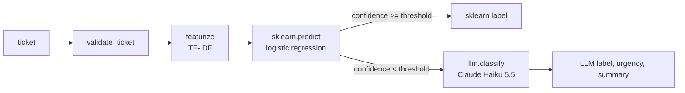

# Langfuse vs Logfire: one ticket router, two traces

A small hybrid predictor with the same instrumentation sent to two backends.
The goal is a like-for-like comparison for a blog post.

## The predictor



- `data/train.csv` has 80 short support tickets in 5 categories.
- `data/eval.csv` has 16 tickets. Some are ambiguous, two are invalid on purpose.
- `FlakyClassifier` injects an LLM timeout on every n-th call (`--fail-every`, default 4).

## Why one seam

The router talks to a `Telemetry` protocol (`src/ticket_router/telemetry/base.py`).
Each backend has one small adapter:

| Adapter | Span | Generation | Error |
|---|---|---|---|
| `logfire_adapter.py` | `logfire.span` | span with `gen_ai.*` and `operation.cost` attributes | recorded by Logfire on exit |
| `langfuse_adapter.py` | `start_as_current_observation(as_type="span")` | `as_type="generation"` with `usage_details` and `cost_details` | recorded by OTel on exit, mapped to level ERROR by the server |

`tests/test_adapters.py` runs both adapters against in-memory exporters.
It asserts that both emit the same span names and the same error spans.

## Run

```bash
uv sync
uv run pytest -q
uv run route-tickets --backend console
```

The `console` backend needs no account and no key.

### Langfuse (self-hosted)

1. Start Docker (OrbStack).
2. Start the official Langfuse Docker Compose stack in `langfuse-server/` (see `docs/langfuse-setup.md`).
3. Open http://localhost:3000, create a project, and copy its keys to `.env`.
4. Run:

```bash
uv run route-tickets --backend langfuse --llm anthropic
```

### Logfire (free cloud tier)

1. Create a Logfire project and a write token.
2. Put the token in `.env` as `LOGFIRE_TOKEN`.
3. Run:

```bash
uv run route-tickets --backend logfire --llm anthropic
```

Add `--native` to let each tool's own Anthropic integration record tokens and cost, instead of the adapter.

Use `--llm stub` to run without an Anthropic key. The stub cost uses Haiku prices on fake token counts.

## Notes

- The Anthropic client runs with `open_telemetry=False`, so the SDK adds no extra spans to one backend only.
- Each backend gets its own run. Real LLM latency and token counts differ a little between runs.
- See `docs/comparison.md` for the draft table for the post.
